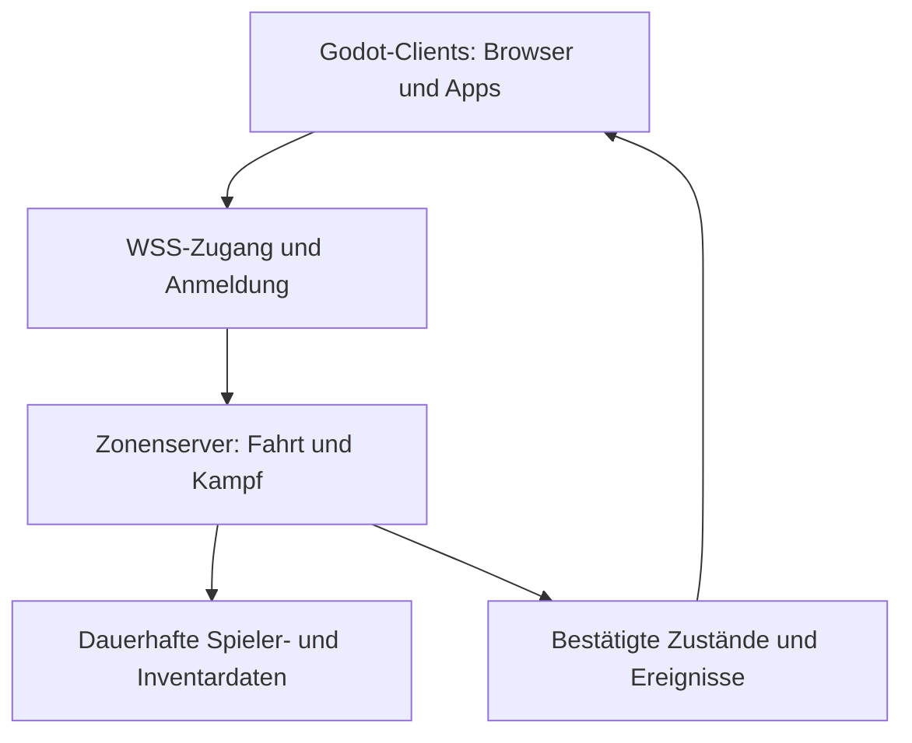

# Abyssal Dominion – Bauplan für das klassische Seekarten-MMO

Stand: 02.11.2026. Gewünschte Engine: **Godot 4.7.2 Standard / GDScript**.
Ziele: Android, iOS, Desktop und Browser mit gemeinsamer Spielwelt.
Referenz: Seafight 2013–2020 und Battle of Sea im heute öffentlich dokumentierten Stand.

## Ergebnis und gewählte Richtung

Wir verwenden den vorhandenen Abyssal-Dominion-Stand M304.9 als Basis. Ein kompletter Neubeginn würde bereits funktionierende Seekarten-Steuerung, Minimap, Munitionsmenü, Zielwahl und Bildadapter verwerfen. Main M302 ist ein älterer Entwicklungszweig; die aktuelle geprüfte Ausgangsbasis ist `rebuild/m3049-mobile-artpack-import`, Commit `958dd7ea0f30a3ce972171e8c6375246401fe0ee`.

Der neue Branch `rebuild/m3050-crossplay-plan` ergänzt eine tatsächlich verbundene, servergesteuerte Testkarte. Er ist ein Entwicklungsstand, kein fertiger Seafight-/Battle-of-Sea-Ersatz.

**Spielerlebnis als Leitlinie:** ein eigenes Schiff auf einer großzügigen schrägen Seekarte, unmittelbar antippbare Fahrtziele, klare Namensschilder, Ziele markieren, bewegungsunabhängiger Fernkampf, unterschiedliche Munition, Monsterjagd, Beutesammeln und schrittweiser Ausbau des Schiffes. Die Referenznähe wird an Kamera, Größenverhältnissen, Steuerung, Kampf und Spielschleifen geprüft.

Arbeitsentscheidung für die erste zusammenhängende Version: Seafight-artige Seekarte mit dem Funktionsumfang eines überschaubaren frühen Spielgebiets; mobile Bedienung nach modernen Anforderungen. Der Zeitraum 2013–2020 enthält mehrere unterschiedliche Systeme und Oberflächen. Wir mischen deren Zahlenwerte nicht unbemerkt. Exakte historische HP-, Kanonen- und Wirtschaftswerte erhalten später getrennte Regelprofile.

## Was die Quellen belegen – und was noch offen bleibt

- Die offizielle Seafight-Seekartenbeschreibung vom März 2018 dokumentiert Minimap, Schnellleisten, Schiffsmenüs, Crew und Quests [S1]. Sie dient als Referenz für die Anordnung und Erreichbarkeit von Funktionen.
- Die offizielle Änderungserklärung von 2014 beschreibt die Verlagerung von Schiffsfunktionen in die Seekarte und die Trennung von Design und Eigenschaften [S2]. Deshalb planen wir Schiffswerte getrennt von kosmetischer Darstellung.
- Battle of Seas öffentliche Roadmap führt mobile konfigurierbare Tasten und weitere Änderungen an Bedienung und Schiffssystemen auf [S3]. Ein Roadmap-Eintrag allein beweist weder das genaue Aussehen jeder Szene noch vollständige aktuelle Spielregeln.
- Der heutige Seafight-FAQ-Index wurde seit 2013 fortgeschrieben [S4]. Sein Erstellungsdatum macht neuere Inhalte nicht zu einem Beleg für 2013. Historische Werte brauchen datierte Einzelbelege.
- Kenneys Pirate Kit und Pirate Pack sind nach den jeweiligen Herstellerseiten CC0 [S5/S6]. Sie sind verwendbare Entwicklungsressourcen, treffen aber nicht den gewünschten detaillierten Grafikstil.

Es wurde kein eingeloggtes Battle-of-Sea-Spiel und keine vollständige historische Seafight-Version live durchgespielt. Historische Bildfolgen, HUD-Abmessungen, Bewegungszeiten und exakte Balance bleiben deshalb teilweise zu vermessen. Eine Behauptung „bereits 1:1 rekonstruiert“ wäre falsch.

## APK-Prüfung: konkret nutzbare Ergebnisse

Keine APK wurde ausgeführt. Untersucht wurden die vom Nutzer bereitgestellten Archive und deren Unity-Objekte mit UnityPy 1.25.4. Archiv-Hashes und Einzelobjektinventare liegen im beigefügten Analysepaket.

| Eingabe | Objektinventar | Erfolgreiche PNG-Dateien | Fehler | Ergebnis |
|---|---:|---:|---:|---|
| SeaBattles 1.24.0 | 662 Texture2D + 765 Sprite | 1.386 | 18 Bildfehler | Schiffsatlanten, Inseln, Monster und UI extrahiert |
| Captain of Sea 1.0 | 2.218 Texture2D + 2.094 Sprite | 4.273 | 9 Bildfehler | Viele einzelne Richtungs-/Animationsbilder, UI und Effekte extrahiert |
| SeaOfLegend.apk | kein vollständiges Objektinventar | 0 | UnityFS/LZ4-Dekodierung abgebrochen | Noch keine belastbare Grafikquelle |
| SeaOfBones 1.3.68.zip | Upload hier nicht verfügbar | – | Datei fehlt | Erneuter Upload erforderlich |

**5.659 PNGs sind nicht 5.659 unterschiedliche Spielobjekte.** Texturen und daraus abgeleitete Sprites können dasselbe Motiv enthalten. Sehr kleine Systembilder wurden übersprungen. Die beiden erfolgreichen Exporte sind trotzdem echte Bilddekodierungen mit Alpha, keine bloße Liste von Dateinamen.

Bei SeaBattles sind unter anderem Warship, Pinnace, FlyingDutchman, Elite-Schiffe, Tiamat, MobyDick, Inselbilder und WaveNoise nachgewiesen. Für den lokalen Grafiktest wurden vier Schiffstexturen, ein Monsteratlas, vier Inseltexturen und eine Wasserrauschtextur ausgewählt. Die zehn ausgewählten PNGs und ihre Herkunft sind im separaten Referenzpaket enthalten.

Wichtig für die Darstellung: Die verwendeten SeaBattles-Schiffsatlanten haben **vier Richtungen und zwei Segelzustände**. Das sind keine acht Richtungen. Für gesunde Schiffe verwenden wir die kontrollierte Reihe mit ausgebreiteten Segeln. Ein Wechsel zwischen Stehen und Fahren darf kein Schiffswrack erzeugen. Zusätzliche Richtungen benötigen passende Einzelbilder oder vollständige 3D-Modelle.

Captain of Sea enthält zahlreiche benannte Schiffs-Einzelbilder. Namensähnlichkeit reicht nicht aus, um daraus verlässlich eine komplette Bewegungsanimation zu bauen. Erst Sortierung, gemeinsamer Ankerpunkt und Sichtprüfung bestimmen die richtige Reihenfolge.

Öffentlich sichtbare oder aus einer APK extrahierte Bilder haben dadurch keine nachgewiesene Veröffentlichungslizenz. Der lokale Referenztest nutzt die bereitgestellten Daten. Öffentliche Exporte verwenden eigene oder ausdrücklich freigegebene Grafiken; unbekannte Rechte werden im Assetregister als offen geführt. Die Referenz-PNGs sind nicht Bestandteil des öffentlichen Git-Branches.

## Funktionsvergleich und tatsächlicher Stand

| System | Zielbild | Heute im Projekt | Nächster Ausbau / Abnahme |
|---|---|---|---|
| Seekarte / Kamera | Schräger Blick, große zusammenhängende Meeresfläche | Vorhandene 3D-Karte mit Sprite-/Modelladapter | Bildvergleich mit festgelegter Referenz, kein zufälliger Kamerastil |
| Fahren | Tippen setzt direkten Kurs, Umfahrung von Küsten | Lokal vorhanden; neu auf Server berechnet | Kurse um alle Inseln bei 15/30/60 FPS testen |
| Zielwahl | NPC, Monster und Spieler klar unterscheidbar | NPC-/Monsterwahl vorhanden | Touch-Auswahl, Zielwechsel, Abbruch und Prioritäten verfeinern |
| Kanonen | Während der Fahrt auf Ziel feuern | Lokal und neue Server-Testkarte | Reisezeit, Trefferreaktion, Salven und Audio synchronisieren |
| Harpunen | Eigener Modus gegen Monster | Lokal und auf Server verfügbar | Monsterverhalten und Jagdquests |
| Munition | Bestände, Nachkauf, erkennbar verschiedene Wirkungen | Eisen, Harpune, Kette; Server prüft Bestände und Kauf | Serverseitige Statuswirkung der Kette ergänzen; nicht als fertig ausgeben |
| Reparatur / Sinken | HP entscheidet über Zustand; klare Rückkehr | Server-HP, Reparatur-Cooldown und Rückkehr nach 8 s | Eigene Sinkanimation und Reparaturregeln mit Kampfunterbrechung |
| Beute | Sichtbare Objekte, einmalige Auszahlung | Server erzeugt Drop, prüft Nähe und Besitzer | Gruppen-/Schadensanteile, Zeitablauf, beständige Beute |
| Schiffsausbau | Rumpf, Kanonen, Decks, Segel, Besatzung | Lokale Werft mit drei Klassen | Werte, Käufe und Freischaltungen auf Server übertragen |
| Quests / Piratenprüfungen | Freischaltung weiterer Karten | Lokaler Einstiegsauftrag | Serverseitige Questzustände und Abschlussbelege |
| Karten / Hafen | PvE/PvP-Gebiete, sichere Häfen und Übergänge | Eine gemeinsame Testzone | Zwei Zonen + Hafen mit sauberem Sitzungsübergang |
| PvP | Zielkampf nach Gebietsregeln | Nicht im neuen Onlineprotokoll | Angriffsberechtigung, Tod, Schutz und Rangpunkte |
| Gilden / Inseln | Gilden, Diplomatie, Türme, Besitz | Nicht an neue Seekarte angebunden | Erst nach Accounts und PvP |
| Events / Bonuskarten | Zeitlich aktivierte NPCs und Instanzen | Nicht an neue Seekarte angebunden | Serverseitiger Zeitplan, Belohnungen und Instanzen |
| Accounts / Speichern | Ein Konto auf allen Plattformen | Neue Zone verwendet flüchtige Gäste | Anmeldung, Charakter-ID, Datenbank und Wiederverbindung |
| Chat / Gruppen / Freunde | Gemeinsame soziale Systeme | Noch nicht im neuen Onlinekern | Moderation, Gruppenregeln, Kanal-/Sprachtrennung |
| Crossplay | Gleiche Welt auf Browser und Apps | Echte lokale WebSocket-Mehrspielerprüfung | Exportierte Plattformen gegen denselben gehosteten WSS-Server testen |

## Technik und Trennung der Verantwortung

Godot 4.7.2 Standard mit GDScript vermeidet eine zusätzliche C#-Web-Exportabhängigkeit. Der Compatibility-Renderer bleibt für Browser und mobile Geräte der gemeinsame Ausgangspunkt. Web-Unterstützung wird mit exportiertem Projekt geprüft, nicht aus dem erfolgreichen Editorstart abgeleitet.

Godot unterstützt WebSocket auf nativen und Web-Plattformen [S7]. Browser-Clients können keinen gewöhnlichen ENet/UDP-Client verwenden [S8]. Deshalb ist **WSS** die geplante gemeinsame Verbindung; ein späterer separater schneller Transport für native Clients darf kein anderes Regelwerk erzeugen.



Client: Eingaben, Kamera, UI, Interpolation, Grafiken, Audio und Darstellung bestätigter Ereignisse.
Server: Position, Kurs, Treffer, Cooldowns, HP, Munition, Beute, Gold und Fortschritt.
Datenbank in einer späteren Phase: Konten, Charaktere, Inventare, Transaktionsbuch und Gilden.

Der neue Testkern läuft mit 20 Simulationsschritten pro Sekunde und sendet bis zu 10 Zustandsbilder pro Sekunde. Diese Werte sind eine Implementierungsentscheidung für den Prototyp, keine vermessene Optimalkonfiguration. Zustände enthalten derzeit alle Spieler und NPCs einer kleinen Zone; das ist kein Skalierungsnachweis für ein MMO.

Neu implementiert: begrenzte Paket-/Befehlsgrößen, maximal 32 Testverbindungen, monotone Befehlsnummern, begrenzte Kursanfragen, Positionsprüfung an Inseln, Ammo-/Reichweitenprüfung und einmalige Drop-Abholung. Positionen, HP oder Guthaben aus Clientdaten werden nicht als Wahrheit übernommen.

Noch erforderlich vor öffentlichem Betrieb: Authentifizierung, serverseitige Namenprüfung, TLS-Zugang, strukturierte Disconnect-/Reconnect-Regeln, belastbare Zeitlimits, Sichtbarkeitsbereiche, persistent gespeicherte Transaktionen, Duplikationsschutz über Neustarts, Last- und Missbrauchstests. Der neue Server bindet standardmäßig nur an Loopback und ist als lokaler Entwicklungsserver bezeichnet.

## Mobile-first: verbindliche Abnahmekriterien

Arbeitsannahme: **Querformat als primäre Kampfansicht**, da die Seekarte und getrennten Bedienelemente horizontalen Platz benötigen. Hochformat ist ein später zu prüfender Zusatz; es wird nicht als bereits unterstützt behauptet.

- Kernaktionen mit mindestens 48 logischen Pixeln Touchfläche; kein Bedienelement überlappt seine Nachbarn.
- Feuer/Reparatur rechts, Kurs/Kamera links, Munition über oder zwischen den Gruppen; Minimap oben rechts.
- Safe-Area-Ränder für Notch und Systemgesten. Physische Geräteprüfung nötig.
- Eine Fingerberührung führt zu genau einem Kurs-/Zielbefehl. Kein doppelter Mouse-/Touch-Befehl.
- Bei Funkloch klare Verbindungsanzeige; keine heimliche lokale Kampfberechnung.
- Betriebssystembedingtes Pausieren oder Beenden auf mobilen Geräten wird als Verbindungsabbruch behandelt. Dauerhafte Hintergrundaktivität kann nicht plattformübergreifend vorausgesetzt werden.
- Startbudget als Ziel: 30 FPS auf dem Referenzhandy, 60 FPS auf geeignetem Desktop; 20–50 sichtbare Schiffe zuerst messen. Noch keine behaupteten Leistungswerte.
- Wasser, transparente Sprites und Effekte erhalten Qualitätsstufen; keine unnötig teuren Vollbildpartikel.

## Umsetzungsreihenfolge mit überprüfbaren Endpunkten

### 1. Referenz- und Asset-Festlegung – begonnen

Eine datierte Referenzmappe für Seekarte, Schiffsskala, Fahrt, Kanonensalve, Harpunen, Loot, Werft, Kartenwechsel und Hafen. Je Merkmal: Quelle, beobachtetes Verhalten, unsere Entscheidung, Status. Vorhandene Altberichte bleiben Orientierung; aktuelle Dateien und tatsächlicher Runtime-Test entscheiden.

Endpunkt: ein Referenzblatt je Kernablauf und eine kuratierte Liste verwertbarer Grafiken. Keine zusätzliche Featurelawine vor der Prüfung des Grundgefühls.

### 2. Verbindbare Kernkarte – erster technischer Durchstich implementiert

Zwei echte Clients im selben Gebiet: fahren, Ziele auswählen, schießen, Munition verbrauchen und dieselbe Beute sehen. Der neue automatisierte Test prüft dies bereits lokal mit dem echten Godot-Szenenadapter und einem zweiten WebSocket-Client.

Endpunkt für die nächste Stufe: dieselbe Prüfung mit **exportiertem Browser und Android-App** auf einem WSS-Testserver. Mobile Sichtprüfung von Tasten, Schiffsgröße und Kamera gehört dazu.

### 3. Durchgängiger Einstieg und Speichern

Account/Gastmigration, ein Schiff, Einführungsauftrag, Hafen, Werft, Ammo-Nachkauf, zwei PvE-Karten und Freischaltung durch Prüfung. Fortschritt über Neustart und Gerätewechsel erhalten.

Endpunkt: vom frischen Konto bis zur zweiten Karte ohne Adminhilfe spielbar; gleichzeitiger Login und wiederholte Belohnungsanforderungen können nichts duplizieren.

### 4. Kampftiefe und Wirtschaft

Schiffsausrüstung, Kanonen-/Crewwerte, Statusmunition, NPC-Patrouillen, Admirals, Schadensbeiträge, Wracks und nachvollziehbare Belohnungen. Balancing in versionierten Daten statt UI-Code.

Endpunkt: klar unterschiedliche Schiffsklassen und Waffen, reproduzierbarer Kampfbericht und konsistente Bestände bei Verbindungsabbruch.

### 5. PvP, Gilden und Live-Inhalte

PvP-Gebiete, sichere Häfen, Gruppen, Gilden, Inselbesitz und Events. Die bereits im älteren Projekt vorhandenen serverseitigen Systeme werden einzeln geprüft und an den neuen Zonekern angeschlossen. Existenz alter Dateien ist kein Beleg für Integration.

Endpunkt: echte Mehrspielerabnahme mit mehreren Geräten, nachvollziehbaren Besitz-/Belohnungsänderungen und sauberen Neustarts.

### 6. Plattformfreigabe und Betrieb

Android mit stabilem Signaturschlüssel und Versionsnummern; Browser mit HTTPS/WSS und geprüften Ladezeiten; Desktop-Exporte; iOS mit macOS/Xcode, Team-ID und Signierung [S9]. Ein Linux-Test allein erzeugt keine gültige iOS-Auslieferung.

Endpunkt: installierte Android-/iOS-Clients, Browser und Desktop treffen sich mit demselben Accountsystem auf demselben Server. Erst dann ist plattformübergreifendes Crossplay abgenommen.

## Starten und selbst prüfen

Projekt in Godot **4.7.2 Standard** importieren und mit F6/F5 starten. Das neue Startmenü bietet die bestehende lokale Seekarte und die neue gemeinsame Testkarte.

Server in einem Terminal:

```bash
godot --headless --path . scenes/network/zone_server.tscn -- --port=9080
```

Zwei Clients starten und im Startmenü `ws://127.0.0.1:9080` eintragen.
Für einen LAN-Test bewusst mit `--bind=0.0.0.0` starten und die lokale IP des Serverrechners verwenden. `127.0.0.1` auf dem Handy bezeichnet das Handy selbst. HTTPS-Webseiten benötigen einen erreichbaren WSS-Endpunkt; ein solcher ist noch nicht gehostet.

Die Grafik-Ergänzung wird auf dem Entwicklungsrechner in den Projektordner entpackt; sie enthält `assets/classic/private_seabattles/pack.json`. Das ist ein Entwicklerpaket für die vorhandene Referenzschnittstelle, **nicht** das ältere Android-Importformat `abyssal_user_art` mit Einzelbildern. Für veröffentlichte Builds sind diese privaten Ressourcen in den Exportfiltern ausgeschlossen.

Tests:

```bash
godot --headless --path . --script tests/network/zone_simulation_test.gd
godot --headless --path . --script tests/network/crossplay_e2e_test.gd
```

## Bekannte Grenzen dieses konkreten Entwicklungsstands

- Ein Testgebiet mit 12 NPC-/Monsterzielen und sechs kreisförmig modellierten Hindernissen.
- Online-NPCs stehen derzeit fest; Patrouillen/Kettenverlangsamung sind noch nicht im Serverkern.
- Online-Werft und Questbelohnungen sind deaktiviert, bis deren serverseitige Transaktionen existieren.
- Gäste verlieren den Zustand bei Trennung bzw. Serverneustart; keine produktive Anmeldung/Datenbank.
- Kampf-HP werden im Test beim Server-Schuss berechnet; das sichtbare Projektil ist nachlaufende Darstellung. Eine echte Flugzeit-/Treffersimulation ist noch auszubauen.
- Fernkampf gegen andere Spieler ist nicht implementiert.
- Online-Darstellung versteckt versenkte Schiffe; die fertige Sinksequenz fehlt.
- Vier geprüfte Richtungen in den ausgewählten Referenz-Schiffsatlanten; keine perfekte freie 3D-Rotation.
- Physisches Android/iOS, Browserexport, Internetlatenz und MMO-Last sind noch nicht abgenommen.

## Quellen

S1: https://board-en.seafight.com/threads/sea-chart-overview.172255/ – Seekartenbeschreibung, 25.03.2018; fortgeschriebene Seite.
S2: https://board-en.seafight.com/threads/transmogrification-milestone-overview.33913/ – Änderungserklärung, 03.06.2014.
S3: https://forum.battleofsea.com/en/thread-38 – offizielle Roadmap; geprüft 02.11.2026.
S4: https://board-en.seafight.com/threads/index.2506/ – fortgeschriebener FAQ-Index, keine eingefrorene 2013-Version.
S5: https://kenney.nl/assets/pirate-kit – CC0, 3D.
S6: https://kenney.nl/assets/pirate-pack – CC0, 2D.
S7: https://docs.godotengine.org/en/stable/tutorials/networking/websocket.html
S8: https://docs.godotengine.org/en/stable/tutorials/export/exporting_for_web.html
S9: https://docs.godotengine.org/en/stable/tutorials/export/exporting_for_ios.html
S10: https://godotengine.org/download/archive/4.7.2-stable/
