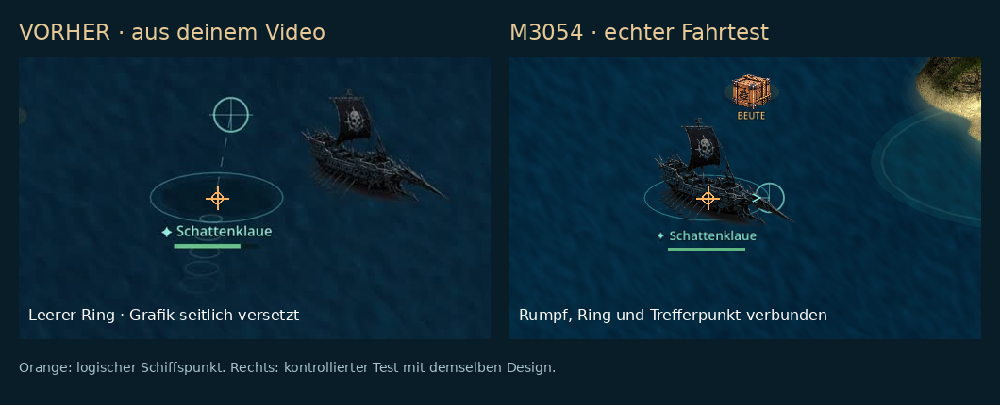

# M3054 ship rendering audit

Evidence: user-supplied `206697.mp4`, 60.742656 s, 2340×1080 at approximately 59.94 fps. The recorded HUD uses M3052's WERFT/AUFTRAG/MENÜ labels; the same ship rendering defects remained in M3053 and are corrected in the active project. This is an analysis of the supplied footage, not a claim that the user had installed M3053.

| Video interval | Observed behavior | Cause | M3054 change |
| --- | --- | --- | --- |
| 0–5 s; 33–60 s | Schattenklaue/Hoellenfeuer draws to the right and above its empty selection ring; movement and loot collection occur at the ring | Reflection added an entire image width to the destination origin before passing a negative width to Godot's drawing API | Draw positive rectangles with a reflected canvas transform around the measured hull anchor; restore the canvas transform after each ship |
| 9–19 s; 36–46 s | NPC view does not consistently agree with its course | Four atlas columns are authored NE, NW, SW, SE, while the previous calculation treated them as clockwise | Explicit clockwise-to-atlas permutation `[0,3,2,1]`; heading hysteresis at quadrant boundaries |
| 0–60 s | Own concept ships and reference hulls have inconsistent size; shadows can appear detached | The renderer sized full texture cells and placed one generic pivot on all ships, despite large and uneven transparent padding | Alpha-measured bounds and individual opaque hull pivots for all 26 ship sources / 74 full-sail frames; size based on visible silhouette |
| 0–5 s; 48–60 s | Large repeated wake rings trail away from the visible ship | Wake used the logical actor point while artwork was displaced; five wide ellipse marks amplified the separation | Shared waterline anchor plus shorter, lower-opacity paired foam strokes |
| 21–32 s | Cosmetic menu presents all designs as if they have equivalent views | Ten user concept crops contain one view; sixteen reference atlases contain four real headings | Clear single-image / four-view labels; tightly cropped shipyard thumbnails |

## Source audit

All 26 original PNG sources are retained unchanged. The measured geometry records their SHA-256 digests and source dimensions under `assets/visuals/ship_frames.json`. Full-sail row 1 is retained for atlas hulls at every positive HP value; hull damage never chooses a damaged-sail row. The Tiamat sheet remains 4×10 and is independent of ship atlas direction mapping.

The measurement tool is `tools/audit_ship_art.py` (Pillow required for developer use). It does not create missing perspectives, recolor ships or rewrite source artwork. Runtime loading uses the small JSON file rather than scanning texture pixels on the phone. The Android builder verifies that this exact JSON is embedded in the APK.

## Verification

`ship_visual_test.gd` covers source dimensions, authored direction order, course hysteresis, reflected geometry, normalized visible size, waterline containment and healthy sail rows. The existing simulation, progression and UI tests remain enabled. `ship_render_capture.gd` uses the actual runtime `_draw_actor` function to capture every design in four course directions, with visible waterline markers. Three galleries distinguish the ten single-view concepts from the sixteen four-view hulls. A separate maneuver recording captures the same concept ship before and after an east-to-west course change.

## Limits

The ten concept images still lack true side, bow and stern views. Their corrected reflection is not advertised as a complete perspective set. The sixteen supplied reference hulls have four authored direction images, not 8/16/32 distinct baked views. Runtime sprite fixes cannot recover geometry that is absent from the input artwork. The source atlases also retain their original resolution/compression defects. This remains local guest gameplay; a physical Android playtest is separate from CI rendering and APK verification.

## Verified M3054 result

Source commit: `9866ec41886111d846b423ac2fe8b0562bf50add`. 881 automated checks passed, including 617 ship geometry checks. APK signature, ARM64 engine, 16 KB alignment, embedded artwork and exact sprite metadata passed. APK SHA-256: `a30a6feaa7a51d1e972b6fafff857dd63fe681756371380d98a7c4ef15c9a85e`. No physical Android playtest was performed.

All 26 designs were inspected in the runtime galleries after rendering. The 3-second, 960×540 east/west maneuver clip shows the supplied Schattenklaue design staying on its waterline anchor through reflection. The comparison below uses a frame from the user's video on the left and a controlled runtime test on the right; these are different captures of the same design, not a synchronized recording.

- [Controlled maneuver video](../../releases/M3054/captures/maneuver/course_change.mp4)
- [All ship view galleries](../../releases/M3054/captures/ship-audit/)
- [Machine-readable build report](../../releases/M3054/ABYSSAL_DOMINION_M3054_REBUILD_ARM64.build.json)
